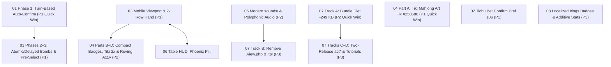

# Tichu Roadmap & Master Plan Index (`plans/00..08`)

Post-Lit-rewrite engineering roadmap for **Tichu on Board Game Arena** (`game=1237`), refreshed on `2026-11-27` against `main` (`8d3c619`, `2026-11-27.1`), [`local/bugs/open-issues.json`](file:///Users/brohlfs/git/tichu/local/bugs/open-issues.json) (**7 open tickets**, **97 closed**), and [`local/bugs/prod-errors-state.json`](file:///Users/brohlfs/git/tichu/local/bugs/prod-errors-state.json) (**0 active prod crashes**).

---

## 1. What to Tackle Next (Prioritized Execution Queue)

### Phase A — Quick-Win Bundle (~1–1.5 days, Low Complexity, High ROI)

1. **[Plan 04 Part A — Tiki Mahjong Art Fix (`#258688`)](file:///Users/brohlfs/git/tichu/plans/04-tiki-art-colorblind-aid-and-keyboard-a11y.md)**: Fix the **only `confirmed` open display bug** (`tichu-value-choice.ts` & `#mahjongIndicator .mahjong` using `img/tichu-icons-table.png` instead of Tiki art under `Pref 103 = 1`).
2. **[Plan 01 Phase 1 — Turn-Based `ST_CONFIRM_TRICK` Smart Auto-Skip](file:///Users/brohlfs/git/tichu/plans/01-turn-based-confirm-autoskip-and-delayed-bombs.md)**: ~70 LOC pure PHP (`resolveTrickCollection()`, `shouldAutoConfirmTrick()`, `ST_CONFIRM_TRICK` `"endRound"`), eliminating dead async `"Collect"` waits when `< 4` cards remain with zero schema/client/migration risk.
3. **[Plan 07 Track A — Production Bundle Diet (`-249 KB` / `-27.3%`)](file:///Users/brohlfs/git/tichu/plans/07-bundle-diet-esm-autowired-actions-and-tutorials.md)**: Move `src/studio-test.ts` (`4,734` lines) out of prod `tichu.js` into host-gated `modules/js/studio-test.js` + single-pass ES2020 `esbuild` (`913.3 KB -> 664.3 KB` unmin / `548.1 KB -> 419.0 KB` min), with zero server/DB/skew risk.
   _(Plus CI hygiene: run `npm run format` on 4 recently touched files currently failing `npx prettier --check`.)_

### Phase B — User-Voted Feature Sprint

4. ~~**[Plan 02 — Optional Tichu Confirmation `Pref 106` (`#119164`, 6v)](file:///Users/brohlfs/git/tichu/plans/02-tichu-call-confirmation-pref-106.md)**~~ — **Superseded (2026-11-27)** by mobile/touch-only `"Tichu"` confirmation (`Tichu::isMobileConfirmContext()` -> `tichuBet` `confirm: 1` triggering backend `confirmTichu` `#page-title` flow, zero new prefs).
5. **[Plan 05 — Modern `sounds/` Polyphonic Audio & `Pref 107` (`#95874`, 0v)](file:///Users/brohlfs/git/tichu/plans/05-modern-bga-sounds-and-polyphonic-audio.md)**: Replace single-`<audio>` cutoff with Web Audio pool + 6 cues, wire `Pref 107` into `<tichu-settings-modal>`, and start the mandatory 1-release overlap for Plan 07 Track B.

### Phase C — Larger High-Impact Investments

6. **[Plan 03 — Mobile Viewport Compliance & 2-Row 14-Card Hand (`#164400`, 1v)](file:///Users/brohlfs/git/tichu/plans/03-mobile-viewport-and-responsive-14-card-hand.md)**: **Implemented locally (2026-11-28)** — `gameinfos.inc.php` `min: 920 -> 360`, Square Table default (`Pref 100 = 2`), `< 760px` `.responsive-compact` (`352px` floor), compact `<tichu-last-played>`/`<tichu-pass-area>`, fluid `cqi` `<tichu-value-choice>`/`<tichu-played-cards>`/`<tichu-trick-modal>`, pre-play single-row `<tichu-action-bar>`, and `0.75×` full-width `<tichu-hand>`/`<tichu-stock>` with `<= 720px` `"2 rows"` toggle (defaulting to 1 row); pending BGA Studio sync + `Reload game informations` / `Reload game options configuration` before production release.
7. **[Plan 01 Phases 2–3 — Delayed Bombs (`#217733`, 4v), Atomic Bombs & Pre-Select](file:///Users/brohlfs/git/tichu/plans/01-turn-based-confirm-autoskip-and-delayed-bombs.md)**: Live `actionlog.log_action varchar(32)` migration, atomic `playBomb`, private `armDelayedBomb`/`cancelDelayedBomb` + `stNextPlayer()` loop (factoring in open `infoneeded` `#258730` Dragon-confirm bomb behavior), plus client-only `preselect$` + `#armedStatusBar`.

### Phase D — Backlog Polish & Long-Term Modernization

8. **[Plan 06 — Table HUD, Phoenix Pill, `<dialog>` Trick Modal & `?` Help](file:///Users/brohlfs/git/tichu/plans/06-table-hud-phoenix-badge-trick-modal-and-help.md)**, **[Plan 04 Parts B–D — Tiki 2x Sprites, Colorblind `Pref 108` & Roving Keyboard A11y](file:///Users/brohlfs/git/tichu/plans/04-tiki-art-colorblind-aid-and-keyboard-a11y.md)**, **[Plan 07 Tracks B–D — Template Removal, Two-Release `act*` & Tutorials](file:///Users/brohlfs/git/tichu/plans/07-bundle-diet-esm-autowired-actions-and-tutorials.md)**, and **[Plan 08 — Localized `#logs` Badges & Additive Stats (`13`, `17..22`)](file:///Users/brohlfs/git/tichu/plans/08-rich-logs-and-additive-stats.md)**.

---

## 2. Dependency Graph

---

## 3. Active Plan Directory (`01`–`08`)

| Plan                                                                                                                                                                 | Priority         | Impact                           | Complexity                                                 | Covered Open Tickets                                                                                                                  |
| :------------------------------------------------------------------------------------------------------------------------------------------------------------------- | :--------------- | :------------------------------- | :--------------------------------------------------------- | :------------------------------------------------------------------------------------------------------------------------------------ |
| [01 — Turn-Based Auto-Skip, Atomic Bombs & Delayed Bombs](file:///Users/brohlfs/git/tichu/plans/01-turn-based-confirm-autoskip-and-delayed-bombs.md)                 | P1               | **Med–High**                     | **Low** (Ph 1) / **High** (Ph 2) / **Med** (Ph 3)          | [#217733](https://boardgamearena.com/bug?id=217733) (4v, `acknowledged`); touches [#258730](https://boardgamearena.com/bug?id=258730) |
| [02 — Optional Tichu Confirmation Preference (`Pref 106`)](file:///Users/brohlfs/git/tichu/plans/02-tichu-call-confirmation-pref-106.md)                             | **Superseded**   | —                                | —                                                          | [#119164](https://boardgamearena.com/bug?id=119164) (6v, mobile-only Tichu confirm)                                                   |
| [03 — Mobile Viewport Compliance & Responsive 14-Card Hand](file:///Users/brohlfs/git/tichu/plans/03-mobile-viewport-and-responsive-14-card-hand.md)                 | P1               | **High**                         | **High**                                                   | [#164400](https://boardgamearena.com/bug?id=164400) (1v, `acknowledged`)                                                              |
| [04 — Tiki Mahjong Fix (`#258688`), Tiki 2x, Colorblind (`Pref 108`) & A11y](file:///Users/brohlfs/git/tichu/plans/04-tiki-art-colorblind-aid-and-keyboard-a11y.md)  | P2 (Part A: P1)  | **Medium**                       | **Low** (Part A) / **Med** (Parts B–D)                     | [#258688](https://boardgamearena.com/bug?id=258688) (1v, `confirmed`)                                                                 |
| [05 — Modern `sounds/` Directory, Polyphonic Audio & `Pref 107`](file:///Users/brohlfs/git/tichu/plans/05-modern-bga-sounds-and-polyphonic-audio.md)                 | P2               | **Medium**                       | **Medium**                                                 | [#95874](https://boardgamearena.com/bug?id=95874) (0v, `acknowledged`)                                                                |
| [06 — Table HUD: Phoenix Badge, `<dialog>` Trick Modal, Last Trick & Help](file:///Users/brohlfs/git/tichu/plans/06-table-hud-phoenix-badge-trick-modal-and-help.md) | P2               | **Medium**                       | **Medium**                                                 | None (`0` open)                                                                                                                       |
| [07 — Bundle Diet (`-249 KB`), ESM, Two-Release `act*` & Tutorials](file:///Users/brohlfs/git/tichu/plans/07-bundle-diet-esm-autowired-actions-and-tutorials.md)     | P3 (Track A: P2) | **High** (A) / **Low–Med** (B–D) | **Low–Med** (A) / **Low** (B) / **High** (C) / **Med** (D) | None (`0` open)                                                                                                                       |
| [08 — Localized `#logs` Badges & Safe Additive Stats (`13`, `17..22`)](file:///Users/brohlfs/git/tichu/plans/08-rich-logs-and-additive-stats.md)                     | P3               | **Low–Medium**                   | **Low–Medium**                                             | None (`0` open)                                                                                                                       |

---

## 4. Open BGA Backlog Matrix (`2026-11-27`)

Sourced from [`local/bugs/open-issues.json`](file:///Users/brohlfs/git/tichu/local/bugs/open-issues.json) (**7 open** / **97 closed**) and [`local/bugs/prod-errors-state.json`](file:///Users/brohlfs/git/tichu/local/bugs/prod-errors-state.json):

| Ticket ID                                           | Votes | Type / Status               | Summary                                                                       | Owning Plan / State                                                                                                                                                                                                                          |
| :-------------------------------------------------- | :---- | :-------------------------- | :---------------------------------------------------------------------------- | :------------------------------------------------------------------------------------------------------------------------------------------------------------------------------------------------------------------------------------------- |
| [#119164](https://boardgamearena.com/bug?id=119164) | 6     | suggestion (`acknowledged`) | Option to require confirmation on Tichu bet (re-opened `2026-11-26`)          | Implemented via mobile-only confirm ([Plan 03](file:///Users/brohlfs/git/tichu/plans/03-mobile-viewport-and-responsive-14-card-hand.md); supersedes [Plan 02](file:///Users/brohlfs/git/tichu/plans/02-tichu-call-confirmation-pref-106.md)) |
| [#217733](https://boardgamearena.com/bug?id=217733) | 4     | suggestion (`acknowledged`) | Delayed bomb in turn-based Tichu                                              | [Plan 01](file:///Users/brohlfs/git/tichu/plans/01-turn-based-confirm-autoskip-and-delayed-bombs.md)                                                                                                                                         |
| [#258730](https://boardgamearena.com/bug?id=258730) | 2     | action (`infoneeded`)       | Can't play bomb on own Dragon (`ST_CHOOSE_DRAGON_GIFT` vs `ST_CONFIRM_TRICK`) | Investigating (intersects [Plan 01](file:///Users/brohlfs/git/tichu/plans/01-turn-based-confirm-autoskip-and-delayed-bombs.md))                                                                                                              |
| [#258688](https://boardgamearena.com/bug?id=258688) | 1     | display (`confirmed`)       | Mahjong wish selector & indicator use standard art instead of Tiki art        | [Plan 04](file:///Users/brohlfs/git/tichu/plans/04-tiki-art-colorblind-aid-and-keyboard-a11y.md) (Part A)                                                                                                                                    |
| [#164400](https://boardgamearena.com/bug?id=164400) | 1     | suggestion (`acknowledged`) | Responsive 2-row 14-card hand layout on narrow viewports                      | [Plan 03](file:///Users/brohlfs/git/tichu/plans/03-mobile-viewport-and-responsive-14-card-hand.md)                                                                                                                                           |
| [#95874](https://boardgamearena.com/bug?id=95874)   | 0     | suggestion (`acknowledged`) | Fast gameplay drops overlapping audio notifications (`sounds/` pool)          | [Plan 05](file:///Users/brohlfs/git/tichu/plans/05-modern-bga-sounds-and-polyphonic-audio.md)                                                                                                                                                |
| [#258743](https://boardgamearena.com/bug?id=258743) | -2    | block (`infoneeded`)        | Could click cards for exchange but not submit (`Table #954092664`)            | Investigating (no plan yet)                                                                                                                                                                                                                  |

- **Production Sentry (`prod-errors-state.json`, checked `2026-11-27T07:36:22Z`, prod `261127-0920`)**: 0 active new crashes (`#801556`, `#801382`, `#807743`, `#808761` all resolved with zero recurrences since Nov 18).

---

## 5. Shared Cross-Plan ID & Schema Registry

- **`gameoptions.inc.php` `$game_preferences`** (`100–105` live; `101` `Teams` default = `4` live):
  - `106`: _(Free — [Plan 02](file:///Users/brohlfs/git/tichu/plans/02-tichu-call-confirmation-pref-106.md) superseded by mobile-only `"Tichu"` confirmation)_
  - `107`: Sound Effects (`needReload => false`) — **[Plan 05](file:///Users/brohlfs/git/tichu/plans/05-modern-bga-sounds-and-polyphonic-audio.md)**
  - `108`: High-Contrast Suit Symbols / Colorblind Aid (`needReload => false`) — **[Plan 04](file:///Users/brohlfs/git/tichu/plans/04-tiki-art-colorblind-aid-and-keyboard-a11y.md)**
- **`localStorage` keys (LIVE)**: `tichu_hand_sort_order`, `tichu_hand_custom_order`, `tichu_card_groups_ui_enabled`.
- **`stats.inc.php`** (never alter Table `11..12` or Player `10..16`):
  - Table `13` (`double_victories`) & Player `17–22` (`first_out_count`, `double_victory_count`, `card_points_captured`, `dogs_played`, `dragons_gifted`, `mahjong_wishes_made`) — **[Plan 08](file:///Users/brohlfs/git/tichu/plans/08-rich-logs-and-additive-stats.md)**
- **`tichu.game.php` `global` labels** (`21–28`, `29` retired, `30` = `GLOBAL_LOCK_VERSION`, `31` = `GLOBAL_CONCEDE_PROPOSAL_BY` **LIVE**).
- **`actionlog` `log_action` keys**:
  - **LIVE**: `unpassCards`, `roundScore`, `concedeProposal`, `concedeAccept`, `concedeCancel`.
  - **Reserved**: `armDelayedBomb`, `cancelDelayedBomb` (requires widening `log_action` `varchar(16) -> varchar(32)`) — **[Plan 01](file:///Users/brohlfs/git/tichu/plans/01-turn-based-confirm-autoskip-and-delayed-bombs.md)**

---

## 6. Archived / Completed Plans Ledger (`Nov 2026`)

| Retired Plan                                              | Resolution & Git Commit(s) / Notes                                                                                                                                                                                                                                                                                                                                                   |
| :-------------------------------------------------------- | :----------------------------------------------------------------------------------------------------------------------------------------------------------------------------------------------------------------------------------------------------------------------------------------------------------------------------------------------------------------------------------- |
| `02-tichu-call-confirmation-pref-106.md`                  | **Superseded (2026-11-27)** — Replaced by mobile/touch-only `"Tichu"` confirmation (`Tichu::isMobileConfirmContext()` -> `tichuBet` `confirm: 1` triggering standard backend `confirmTichu` `#page-title` flow, zero new preferences).                                                                                                                                               |
| `01-backend-security-128k-guard-and-version-sync.md`      | **Completed** (`1155b14`, `fce744f`, `64ed1b5`) — `TICHU_CODE_VERSION`, rollback-aware `checkVersion()`, 128 KB zombie circuit breaker (Sentry `#801556` & `#801382` resolved), `capturedCards` privacy gate, SQL/PRNG hardening.                                                                                                                                                    |
| `02-i18n-translation-hq-static-extraction.md`             | **Completed** (`1155b14`, `fce744f`, `41d06bf`) — Direct `_()` extraction across Lit/TS (`237` literals in `tichu.js`), `CardManager::cardToStr()`, `Combo::toLogSpec()` Release 2, `NotificationMessage`; `#78193` & `#175241` closed `fixed`.                                                                                                                                      |
| `03-layout-stability-anti-jump-and-mahjong-no-wish.md`    | **Completed** (`ab32fe5`, `bfbd344`, `b36236c`, `0984fb4`, `b60c00f`) — Permanent 6-col `<tichu-action-bar>` CSS Grid, `#noWish_button`, shortened status labels, fixed-slot player-panel icons; `#25627` & `#204088` closed `implemented`.                                                                                                                                          |
| `05-hand-organization-drag-reorder-and-combo-grouping.md` | **Completed** (`3f88c97`, `f3fa2bc`, `770b25b`) — Post-passing drag-to-reorder (`DRAG_DEADZONE_PX = 16`), 4-way sort dropdown (`Rank ↑/↓`, `Suit ↑/↓`, `Custom`), clickable middle `Groups 1–4` stripes; `#22264` & `#258736` closed `implemented`. _(Pre-passing drag/groups intentionally omitted via `canOrganizeHandInState()`.)_                                                |
| `07-passing-undo-tichu-reset-and-received-badges.md`      | **Completed** (`4b3c0e1`, `01abc63`) — Received-card sender-avatar badges (`#257404`), auto-reopen passes on Tichu call (`#31597`), manual `"Undo Pass"` (`#218304`); all 3 tickets closed `implemented`. _(Cosmetic waiting-state `givenCards` locked-slot preview omitted; `"Undo Pass"` recovers pre-slotted cards cleanly.)_                                                     |
| `10-live-round-scoreboard-and-replay-teams.md`            | **Completed** (`23e7f4f`, `d41bb47`) — `roundScore` persistence/reconciliation, single-line `<tichu-score-board>` + `<tichu-score-modal>`, `player.team` replay fix; `#36912` closed `implemented`.                                                                                                                                                                                  |
| `15-partnership-mutual-concede.md`                        | **Completed** (`5e186ff`) — Scaled partnership mutual concede (`global 31`, `CONCEDE_MIN_ROUND = 2`, `300/400/500`), `#concede_button` & `#concede-banner`; `#36963` closed `implemented`.                                                                                                                                                                                           |
| `16-lobby-team-options-and-tmdisplay.md`                  | **Completed** (`9a0ff71`, release `261127-0920`) — Default Teams option `101` flipped to `4` (`At random`), `#95467` closed `implemented`, `#95469` & `#35575` closed `rejected`. _(Optional local-only housekeeping: align `playerTeams` fallback `1 -> 4` in `local/Bga/GameFramework/Table.php`, `router.php`, `bga-shim.js`, `import-bug-sql.php` + pin `local/scenarios.php`.)_ |
| `17-ci-pipeline-replay-tests-and-contract-hardening.md`   | **Completed** (`1155b14`, `fce744f`, `64ed1b5`) — `.github/workflows/ci.yml` MySQL 8.0 `SERIALIZABLE` CI, `ReplayEngine` + `tests/replay.test.ts` + fixture, PHPStan Level 6, hardened `check-contracts.php`.                                                                                                                                                                        |
| _(Earlier Nov 13–14 retired plans)_                       | `00` (`ce6fab5`), `01` (`ce6fab5`), `02` (`92361a4`), `03` (`0ef6230`), `04` (`791c7fc`, `b700b33`), `05` (`58fcaf1`, `b700b33`, `8c72a13`), `07` (`67f6b81`, `12244bc`, `2ee95cd`, `ef6a954`).                                                                                                                                                                                      |
