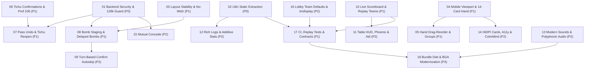

# Tichu Week Roadmap & Master Plan Index (`plans/00..18`)

This directory is the post-Lit-rewrite engineering roadmap for **Tichu on Board Game Arena** (`game=1237`), covering **100% (`24 / 24`) of open BGA bug/suggestion reports**, active production Sentry incidents (`#801556`, `#801382`), and high-leverage architectural/security upgrades across **18 execution-ready blueprints** organized into a 7-day release sequence.

---

## 1. Executive Overview & 7-Day Execution Schedule

| Batch / Day | Included Plans                                                                                                                                                                                                                                                                                                                                                                                                                                                             | Theme & Release Strategy                                                                                                                                                                                                                                                                                         |
| :---------- | :------------------------------------------------------------------------------------------------------------------------------------------------------------------------------------------------------------------------------------------------------------------------------------------------------------------------------------------------------------------------------------------------------------------------------------------------------------------------- | :--------------------------------------------------------------------------------------------------------------------------------------------------------------------------------------------------------------------------------------------------------------------------------------------------------------- |
| **Day 1**   | [01 — Backend Security & 128k Guard](file:///Users/brohlfs/git/tichu/plans/01-backend-security-128k-guard-and-version-sync.md), [02 — i18n Extraction](file:///Users/brohlfs/git/tichu/plans/02-i18n-translation-hq-static-extraction.md), [17 — CI & Replay Tests](file:///Users/brohlfs/git/tichu/plans/17-ci-pipeline-replay-tests-and-contract-hardening.md)                                                                                                           | **P0 Stability & Quality Shield** — Fix 128 KB notification crash, `capturedCards` leak, `LogManager::insert()` SQL escaping, rollback-aware `checkVersion`, Translation HQ extraction, and CI/replay tests (can ship as **Release 1**).                                                                         |
| **Day 2**   | [03 — Layout Stability & No-Wish](file:///Users/brohlfs/git/tichu/plans/03-layout-stability-anti-jump-and-mahjong-no-wish.md), [04 — Mobile Viewport & 14-Card Hand](file:///Users/brohlfs/git/tichu/plans/04-mobile-viewport-and-responsive-14-card-hand.md)                                                                                                                                                                                                              | **UI Polish & Mobile Compliance** — Stop `#page-title` / action-bar layout jumps, add dedicated `"No wish"` button, fix `gameinfos.inc.php` `min: 500`, modernize compact controls, and wrap 14-card mobile hands cleanly.                                                                                       |
| **Day 3**   | [05 — Hand Drag-Reorder & Groups](file:///Users/brohlfs/git/tichu/plans/05-hand-organization-drag-reorder-and-combo-grouping.md), [06 — Tichu Call Confirmations](file:///Users/brohlfs/git/tichu/plans/06-tichu-call-confirmations-and-partner-safeguards.md)                                                                                                                                                                                                             | **High-Vote Player Ergonomics** — Deliver `#22264` (37v) drag-to-reorder + high-special descending sort + combo grouping, and `#97310` (14v) / `#80004` Tichu bet confirmation Pref `106` & pass-phase clarity (**Release 2**).                                                                                  |
| **Day 4**   | [07 — Passing Undo & Tichu Reopen](file:///Users/brohlfs/git/tichu/plans/07-passing-undo-tichu-reset-and-received-badges.md), [08 — Bomb Staging & Delayed Bombs](file:///Users/brohlfs/git/tichu/plans/08-bomb-staging-self-bomb-preselect-and-delayed-bombs.md)                                                                                                                                                                                                          | **Concurrency-Critical Gameplay UX** — Deliver `#31597` (28v) pass reopen on Tichu + `#218304` Undo Pass + received-card origin badges, and local bomb staging + persistent `[Play a Bomb]` (`#106651`) + turn-based delayed bombs (`#217733`).                                                                  |
| **Day 5**   | [09 — Turn-Based Confirm Autoskip](file:///Users/brohlfs/git/tichu/plans/09-turn-based-confirm-trick-smart-autoskip.md), [10 — Live Round Scoreboard](file:///Users/brohlfs/git/tichu/plans/10-live-round-scoreboard-and-replay-teams.md), [11 — Table HUD, Phoenix & Aid](file:///Users/brohlfs/git/tichu/plans/11-table-hud-phoenix-badge-last-trick-and-player-aid.md)                                                                                                  | **Turn-Based Pacing & Match HUD** — Auto-collect async tricks when `< 4` cards remain (after delayed-bomb check), live round-by-round scorepad (`#36912`, `player.team` replay fix), Phoenix table badge (`#161585`), pass Round counter (`#52829`), `"Remaining Cards"`, Last Trick & `?` Help (**Release 3**). |
| **Day 6**   | [12 — Rich Logs & Stats](file:///Users/brohlfs/git/tichu/plans/12-rich-logs-phoenix-combos-and-additive-stats.md), [13 — Polyphonic Audio (`sounds/`)](file:///Users/brohlfs/git/tichu/plans/13-modern-bga-sounds-and-polyphonic-audio.md), [14 — HiDPI Cards & A11y](file:///Users/brohlfs/git/tichu/plans/14-hidpi-card-clarity-a11y-and-colorblind-suits.md), [15 — Partnership Mutual Concede](file:///Users/brohlfs/git/tichu/plans/15-partnership-mutual-concede.md) | **Depth, Accessibility & Match Flow** — `(with Phoenix)` combo logs + `#logs` badges + stats `13`/`17–22`, polyphonic Web Audio + Pref `107`, 2x HiDPI card sprites (`#36611`) + ARIA/keyboard + colorblind Pref `108`, and mutual concede (`#36963`).                                                           |
| **Day 7**   | [16 — Lobby Team Defaults](file:///Users/brohlfs/git/tichu/plans/16-lobby-team-options-and-tmdisplay.md), [18 — Bundle Diet & BGA Modernization](file:///Users/brohlfs/git/tichu/plans/18-bundle-diet-modern-bga-esm-autowired-actions-and-tutorials.md)                                                                                                                                                                                                                   | **Lobby Fairness & Platform Modernization** — Set `Teams: At random` default (`#95467`/`#95469`), strip `-300 KB` `studio-test.ts` out of prod `tichu.js`, single-pass ES2020 build, `.tpl`/`.view.php` removal, two-release `act*` autowiring, and Tutorial Creator anchors (**Release 4**).                    |

---

## 2. Dependency Graph

---

## 3. Master Plan Directory (`01`–`18`)

| Plan                                                                                                                                                                                                            | Priority | Day   | Effort    | Covered Tickets / Prod Issues                                    |
| :-------------------------------------------------------------------------------------------------------------------------------------------------------------------------------------------------------------- | :------- | :---- | :-------- | :--------------------------------------------------------------- |
| [01 — Backend Security, 128 KB Notification Guard & Rollback-Aware Version Sync](file:///Users/brohlfs/git/tichu/plans/01-backend-security-128k-guard-and-version-sync.md)                                      | P0       | Day 1 | Medium    | Sentry `#801556`, `#801382`, technical hardening                 |
| [02 — i18n & BGA Translation HQ Static Extraction Fix](file:///Users/brohlfs/git/tichu/plans/02-i18n-translation-hq-static-extraction.md)                                                                       | P0       | Day 1 | Medium    | `#78193` (6v), `#175241` (1v)                                    |
| [03 — Layout Stability (Anti-Jump Status & Action Bar) and Dedicated Mahjong 'No Wish' Button](file:///Users/brohlfs/git/tichu/plans/03-layout-stability-anti-jump-and-mahjong-no-wish.md)                      | P1       | Day 2 | Small–Med | `#204088` (2v), `#25627` (7v), `#119164` (4v shift)              |
| [04 — Mobile Viewport Compliance, Modern Compact Controls & Responsive 14-Card Hand](file:///Users/brohlfs/git/tichu/plans/04-mobile-viewport-and-responsive-14-card-hand.md)                                   | P1       | Day 2 | Medium    | `#164400` (1v wrap), `#257135` (1v), `gameinfos` spec            |
| [05 — Hand Organization: Drag-to-Reorder, Descending/High-Special Sort & Combo Grouping](file:///Users/brohlfs/git/tichu/plans/05-hand-organization-drag-reorder-and-combo-grouping.md)                         | P1       | Day 3 | Med–Large | `#22264` (37v), `#164400` (1v holder)                            |
| [06 — Tichu & Grand Tichu Confirmation Safeguards (Pref 106, Partner Warning & Pass Placement)](file:///Users/brohlfs/git/tichu/plans/06-tichu-call-confirmations-and-partner-safeguards.md)                    | P1       | Day 3 | Medium    | `#97310` (14v), `#80004` (1v), `#119164` (4v confirm)            |
| [07 — Card Passing: Undo Pass, Auto-Reopen on Tichu Call & Received-Card Origin Badges](file:///Users/brohlfs/git/tichu/plans/07-passing-undo-tichu-reset-and-received-badges.md)                               | P1       | Day 4 | Medium    | `#31597` (28v), `#218304` (1v)                                   |
| [08 — Local Bomb Staging, Persistent Bomb Button, Pre-Select & Turn-Based Delayed Bombs](file:///Users/brohlfs/git/tichu/plans/08-bomb-staging-self-bomb-preselect-and-delayed-bombs.md)                        | P1       | Day 4 | Med–Large | `#106651` (8v), `#217733` (4v)                                   |
| [09 — Turn-Based `ST_CONFIRM_TRICK` Smart Auto-Skip (Coordinated with Delayed Bombs & Dragon)](file:///Users/brohlfs/git/tichu/plans/09-turn-based-confirm-trick-smart-autoskip.md)                             | P2       | Day 5 | Small     | `#217733` (4v joint), async `Collect` stalls                     |
| [10 — Live Round-by-Round Scoreboard Modal & `player.team` Replay Fix](file:///Users/brohlfs/git/tichu/plans/10-live-round-scoreboard-and-replay-teams.md)                                                      | P1       | Day 5 | Medium    | `#36912` (13v)                                                   |
| [11 — Table HUD: Realized Phoenix Badge, Pass Round Indicator, 'Remaining Cards', Last Trick & '?' Help](file:///Users/brohlfs/git/tichu/plans/11-table-hud-phoenix-badge-last-trick-and-player-aid.md)         | P2       | Day 5 | Medium    | `#161585` (1v), `#52829` (1v), `#99318` (1v)                     |
| [12 — Rich `#logs` Badges, '(with Phoenix)' Combo Logs & Safe Additive Stats](file:///Users/brohlfs/git/tichu/plans/12-rich-logs-phoenix-combos-and-additive-stats.md)                                          | P2       | Day 6 | Medium    | `#142475` (2v), `#logs` + `stats.inc.php`                        |
| [13 — Modern `sounds/` Directory, Polyphonic Audio Pool & Preference 107](file:///Users/brohlfs/git/tichu/plans/13-modern-bga-sounds-and-polyphonic-audio.md)                                                   | P2       | Day 6 | Medium    | `#95874` (1v)                                                    |
| [14 — HiDPI 2x Card Sprites, Table Card Legibility, Keyboard/ARIA Accessibility & Colorblind Aid (Pref 108)](file:///Users/brohlfs/git/tichu/plans/14-hidpi-card-clarity-a11y-and-colorblind-suits.md)          | P2       | Day 6 | Medium    | `#36611` (8v)                                                    |
| [15 — Partnership Mutual Concede (`global 31`, Zero-Stall Handshake & Replay Support)](file:///Users/brohlfs/git/tichu/plans/15-partnership-mutual-concede.md)                                                  | P2       | Day 6 | Medium    | `#36963` (13v)                                                   |
| [16 — Lobby Team Defaults (`Teams: At random`) & `tmdisplay` Lobby Visibility](file:///Users/brohlfs/git/tichu/plans/16-lobby-team-options-and-tmdisplay.md)                                                    | P2       | Day 7 | Small     | `#95467` (4v), `#95469` (3v); `#35575` closed `rejected` context |
| [17 — GitHub Actions MySQL 8.0 CI, `<tichu-replay>` Stream Tests & Contract Hardening](file:///Users/brohlfs/git/tichu/plans/17-ci-pipeline-replay-tests-and-contract-hardening.md)                             | P1       | Day 1 | Med–Large | CI, replay regression suite, contract shield                     |
| [18 — Production Bundle Diet (-300 KB), Single-Pass ESM, Two-Release `act*` Actions & Tutorial Creator](file:///Users/brohlfs/git/tichu/plans/18-bundle-diet-modern-bga-esm-autowired-actions-and-tutorials.md) | P3       | Day 7 | Large     | `-300 KB` JS diet, ESM, `act*`, Tutorial Creator                 |

---

## 4. Complete 24-Ticket Open Backlog & Sentry Traceability Matrix

Sorted by community votes descending (sourced from [`local/bugs/open-issues.json`](file:///Users/brohlfs/git/tichu/local/bugs/open-issues.json) and [`local/bugs/prod-errors-state.json`](file:///Users/brohlfs/git/tichu/local/bugs/prod-errors-state.json) as of `2026-11-18`):

| Ticket / Sentry ID                                  | Votes | Type / Status                             | Summary                                                                    | Owning Plan(s)                                                                                                                                                                                                 |
| :-------------------------------------------------- | :---- | :---------------------------------------- | :------------------------------------------------------------------------- | :------------------------------------------------------------------------------------------------------------------------------------------------------------------------------------------------------------- |
| [#22264](https://boardgamearena.com/bug?id=22264)   | 37    | suggestion (`acknowledged`)               | Variable order of cards in hand (drag-and-drop, descending, high specials) | [Plan 05](file:///Users/brohlfs/git/tichu/plans/05-hand-organization-drag-reorder-and-combo-grouping.md)                                                                                                       |
| [#31597](https://boardgamearena.com/bug?id=31597)   | 28    | suggestion (`acknowledged`)               | Reopen locked passes if a player calls Tichu during card passing           | [Plan 07](file:///Users/brohlfs/git/tichu/plans/07-passing-undo-tichu-reset-and-received-badges.md)                                                                                                            |
| [#97310](https://boardgamearena.com/bug?id=97310)   | 14    | suggestion (`acknowledged`)               | Confirmation for Tichu / Grand Tichu & pass-phase button clarity           | [Plan 06](file:///Users/brohlfs/git/tichu/plans/06-tichu-call-confirmations-and-partner-safeguards.md)                                                                                                         |
| [#36912](https://boardgamearena.com/bug?id=36912)   | 13    | suggestion (`awaiting` -> `acknowledged`) | Live round-by-round score sheet                                            | [Plan 10](file:///Users/brohlfs/git/tichu/plans/10-live-round-scoreboard-and-replay-teams.md)                                                                                                                  |
| [#36963](https://boardgamearena.com/bug?id=36963)   | 13    | suggestion (`acknowledged`)               | Partnership mutual concede (Spades model)                                  | [Plan 15](file:///Users/brohlfs/git/tichu/plans/15-partnership-mutual-concede.md)                                                                                                                              |
| [#36611](https://boardgamearena.com/bug?id=36611)   | 8     | suggestion (`acknowledged`)               | Increase cards' image resolution + table card readability                  | [Plan 14](file:///Users/brohlfs/git/tichu/plans/14-hidpi-card-clarity-a11y-and-colorblind-suits.md)                                                                                                            |
| [#106651](https://boardgamearena.com/bug?id=106651) | 8     | suggestion (`acknowledged`)               | Keep `[Play Bomb]` available on own turn (self-bombing)                    | [Plan 08](file:///Users/brohlfs/git/tichu/plans/08-bomb-staging-self-bomb-preselect-and-delayed-bombs.md)                                                                                                      |
| [#25627](https://boardgamearena.com/bug?id=25627)   | 7     | suggestion (`acknowledged`)               | Dedicated `"No wish"` button next to `"Make a wish"`                       | [Plan 03](file:///Users/brohlfs/git/tichu/plans/03-layout-stability-anti-jump-and-mahjong-no-wish.md)                                                                                                          |
| [#78193](https://boardgamearena.com/bug?id=78193)   | 6     | translation (`confirmed`)                 | Untranslated log text, combo names, score screen & tooltips                | [Plan 02](file:///Users/brohlfs/git/tichu/plans/02-i18n-translation-hq-static-extraction.md)                                                                                                                   |
| [#95467](https://boardgamearena.com/bug?id=95467)   | 4     | suggestion (`acknowledged`)               | Default team arrangement `"At random"` (`101 = 4`)                         | [Plan 16](file:///Users/brohlfs/git/tichu/plans/16-lobby-team-options-and-tmdisplay.md)                                                                                                                        |
| [#119164](https://boardgamearena.com/bug?id=119164) | 4     | suggestion (`acknowledged`)               | Option to confirm Tichu bet + stop Bomb/Tichu button jump                  | [Plan 03](file:///Users/brohlfs/git/tichu/plans/03-layout-stability-anti-jump-and-mahjong-no-wish.md) & [Plan 06](file:///Users/brohlfs/git/tichu/plans/06-tichu-call-confirmations-and-partner-safeguards.md) |
| [#217733](https://boardgamearena.com/bug?id=217733) | 4     | suggestion (`acknowledged`)               | Delayed bomb in turn-based Tichu before `Collect`                          | [Plan 08](file:///Users/brohlfs/git/tichu/plans/08-bomb-staging-self-bomb-preselect-and-delayed-bombs.md) & [Plan 09](file:///Users/brohlfs/git/tichu/plans/09-turn-based-confirm-trick-smart-autoskip.md)     |
| [#95469](https://boardgamearena.com/bug?id=95469)   | 3     | suggestion (`inforequest`)                | Display team assignment from open-table lobby (`tmdisplay`)                | [Plan 16](file:///Users/brohlfs/git/tichu/plans/16-lobby-team-options-and-tmdisplay.md)                                                                                                                        |
| [#142475](https://boardgamearena.com/bug?id=142475) | 2     | suggestion (`acknowledged`)               | Indicate Phoenix in `#logs` when part of a non-single combo                | [Plan 12](file:///Users/brohlfs/git/tichu/plans/12-rich-logs-phoenix-combos-and-additive-stats.md)                                                                                                             |
| [#204088](https://boardgamearena.com/bug?id=204088) | 2     | suggestion (`acknowledged`)               | Screen jumps every play as `#page-title` status box wraps                  | [Plan 03](file:///Users/brohlfs/git/tichu/plans/03-layout-stability-anti-jump-and-mahjong-no-wish.md)                                                                                                          |
| [#52829](https://boardgamearena.com/bug?id=52829)   | 1     | suggestion (`acknowledged`)               | Round number indicator visible on exchange cards screen                    | [Plan 11](file:///Users/brohlfs/git/tichu/plans/11-table-hud-phoenix-badge-last-trick-and-player-aid.md)                                                                                                       |
| [#80004](https://boardgamearena.com/bug?id=80004)   | 1     | suggestion (`acknowledged`)               | Always confirm calling Tichu after partner already called                  | [Plan 06](file:///Users/brohlfs/git/tichu/plans/06-tichu-call-confirmations-and-partner-safeguards.md)                                                                                                         |
| [#95874](https://boardgamearena.com/bug?id=95874)   | 1     | suggestion (`acknowledged`)               | Fast gameplay drops overlapping audio notifications                        | [Plan 13](file:///Users/brohlfs/git/tichu/plans/13-modern-bga-sounds-and-polyphonic-audio.md)                                                                                                                  |
| [#99318](https://boardgamearena.com/bug?id=99318)   | 1     | suggestion (`acknowledged`)               | Rename `"Played Cards"` panel to `"Remaining Cards"`                       | [Plan 11](file:///Users/brohlfs/git/tichu/plans/11-table-hud-phoenix-badge-last-trick-and-player-aid.md)                                                                                                       |
| [#161585](https://boardgamearena.com/bug?id=161585) | 1     | suggestion (`acknowledged`)               | Display realized Phoenix value badge on the table                          | [Plan 11](file:///Users/brohlfs/git/tichu/plans/11-table-hud-phoenix-badge-last-trick-and-player-aid.md)                                                                                                       |
| [#164400](https://boardgamearena.com/bug?id=164400) | 1     | suggestion (`acknowledged`)               | Responsive 2-row hand layout & combo holder grouping                       | [Plan 04](file:///Users/brohlfs/git/tichu/plans/04-mobile-viewport-and-responsive-14-card-hand.md) & [Plan 05](file:///Users/brohlfs/git/tichu/plans/05-hand-organization-drag-reorder-and-combo-grouping.md)  |
| [#175241](https://boardgamearena.com/bug?id=175241) | 1     | translation (`confirmed`)                 | `"Give cards to [player name]"` button untranslated                        | [Plan 02](file:///Users/brohlfs/git/tichu/plans/02-i18n-translation-hq-static-extraction.md)                                                                                                                   |
| [#218304](https://boardgamearena.com/bug?id=218304) | 1     | suggestion (`acknowledged`)               | `"Undo Pass"` (`unpassCards`) while waiting in `ST_GIVE_CARDS`             | [Plan 07](file:///Users/brohlfs/git/tichu/plans/07-passing-undo-tichu-reset-and-received-badges.md)                                                                                                            |
| [#257135](https://boardgamearena.com/bug?id=257135) | 1     | suggestion (`awaiting`)                   | Remove cluttered UI texts; make interface modern, responsive & clean       | [Plan 04](file:///Users/brohlfs/git/tichu/plans/04-mobile-viewport-and-responsive-14-card-hand.md)                                                                                                             |
| Sentry `#801556`, `#801382`                         | 3     | prod `feException`                        | `Error: generated notifications are larger than 128k`                      | [Plan 01](file:///Users/brohlfs/git/tichu/plans/01-backend-security-128k-guard-and-version-sync.md)                                                                                                            |

---

## 5. Shared Cross-Plan ID & Schema Registry

- **`gameoptions.inc.php` `$game_preferences`** (`100–105` live; `105` = Animations):
  - `106`: Confirm Tichu / Grand Tichu bets (`needReload => false`) — **Plan 06**
  - `107`: Sound Effects (`needReload => false`) — **Plan 13**
  - `108`: High-Contrast Suit Symbols / Colorblind Aid (`needReload => false`) — **Plan 14**
  - `localStorage` keys (`tichu_hand_sort_order`, `tichu_hand_custom_order`) — **Plan 05**
- **`stats.inc.php`** (never alter Table `11..12` or Player `10..16`):
  - Table `13`: `double_victories` — **Plan 12**
  - Player `17–22`: `first_out_count`, `double_victory_count`, `card_points_captured`, `dogs_played`, `dragons_gifted`, `mahjong_wishes_made` — **Plan 12**
- **`tichu.game.php` `global` labels** (`21–28`, `29` retired, `30` = `GLOBAL_LOCK_VERSION`):
  - `31`: `concedeProposalBy` (must also be added to `local/import-bug-sql.php` Surface 2) — **Plan 15**
- **`actionlog` `log_action` keys** (note `dbmodel.sql` `varchar(16)` widened to `varchar(32)` in **Plan 08**; any embedded `player_id`s mapped in `local/import-bug-sql.php` Surface 4):
  - `unpassCards` — **Plan 07**
  - `armDelayedBomb` / `cancelDelayedBomb` — **Plan 08**
  - `roundScore` — **Plan 10**
  - `concedeProposal` / `concedeAccept` / `concedeCancel` — **Plan 15**

---

## 6. Archived / Deleted Plans Ledger (`Nov 2026`)

| Deleted Old Plan (Nov 13–14)                     | Resolution & Git Commit(s)                                                                                                                                                                                                                                                                             |
| :----------------------------------------------- | :----------------------------------------------------------------------------------------------------------------------------------------------------------------------------------------------------------------------------------------------------------------------------------------------------- |
| `00-live-bugs-and-bga-compliance-fixes.md`       | **Completed** (`ce6fab5`) — selection retention, `grandTichuBet` replay parse, zombie `bga_rand` & wish compliance, `dbmodel.sql` `--` fix.                                                                                                                                                            |
| `01-static-contracts-phpstan-and-ci.md`          | **Completed core + Superseded** (`ce6fab5`) — `src/types/tichu-contracts.ts`, `local/check-contracts.php`, `phpstan.neon` landed; remaining GitHub Actions CI + contract hardening moved to [Plan 17](file:///Users/brohlfs/git/tichu/plans/17-ci-pipeline-replay-tests-and-contract-hardening.md).    |
| `02-agent-skills-and-docs-restructure.md`        | **Completed** (`92361a4`) — lean `AGENTS.md` + 4 `.agents/skills/*/SKILL.md` skills; `BGA_STUDIO_TESTING.md` retired.                                                                                                                                                                                  |
| `03-zero-reload-preferences-and-two-way-sync.md` | **Completed** (`0ef6230`) — `needReload => false` on prefs `100–105`, `safeGetPref`, two-way `#myhandwrap` sync.                                                                                                                                                                                       |
| `04-client-combo-validator-and-smart-play-ux.md` | **Completed** (`791c7fc`, `b700b33`) — `combo-validator.ts` + 3,020-line TS parity suite, wish-match highlight, wish-bomb callout.                                                                                                                                                                     |
| `05-flip-card-flight-animations.md`              | **Completed** (`58fcaf1`, `b700b33`, `8c72a13`) — `<tichu-animation-layer>` WAAPI flights + FLIP sort + `pref 105`.                                                                                                                                                                                    |
| `07-production-bug-sql-loader.md`                | **Completed & Redesigned** (`67f6b81`, `12244bc`, `2ee95cd`, `ef6a954`) — moved out of `modules/DebugTrait.php` (blocked by Studio `workspace.blocked-files`) into `local/import-bug-sql.php` (`bug:import` / `bug:inspect`), `window.__tichuBreadcrumbs`, `logProdWarn`.                              |
| `06`, `08`, `09`, `10`, `11`, `12`, `13`, `14`   | **Superseded / Split & Refreshed** into active Plans [04](file:///Users/brohlfs/git/tichu/plans/04-mobile-viewport-and-responsive-14-card-hand.md)–[18](file:///Users/brohlfs/git/tichu/plans/18-bundle-diet-modern-bga-esm-autowired-actions-and-tutorials.md) against the post-Lit-rewrite codebase. |
